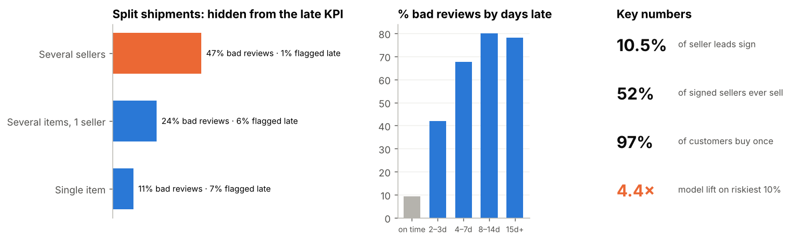
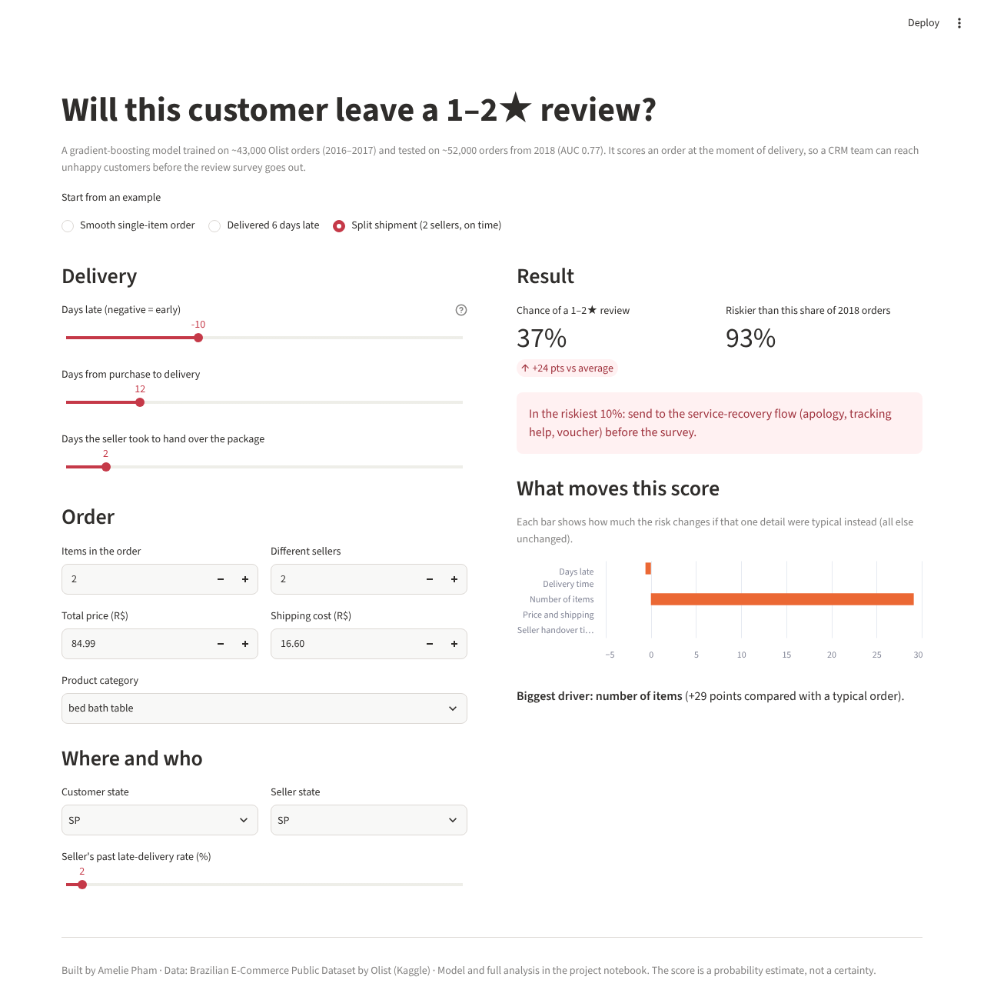

# The hidden reason Olist customers leave 1★ reviews: split shipments

*From Lead to Loyal*: an end-to-end analysis of Olist, a Brazilian marketplace startup, from its seller acquisition funnel to delivery, customer reviews and a machine learning model that powers a CRM service-recovery flow.

**Amelie Pham** · MS Management & Analytics, NYU SPS
**Tools:** SQL (DuckDB + jupysql) · Python (pandas, scikit-learn, matplotlib) · NLP (TF-IDF + NMF) · LLM (Claude) · Streamlit · A/B test design



## The finding
Orders with items from **several sellers** get a 1–2★ review **47%** of the time, versus 11% for single items. They arrive in pieces, yet only ~1% are flagged "late", so the main delivery KPI can't see them. Customers say it in their own words: *"Comprei duas unidades, apenas uma foi entregue"* ("I bought two units, only one was delivered").

## Key results
| # | Finding | Number |
|---|---|---|
| 1 | Seller leads that sign | 10.5% (842 of 8,000) |
| 2 | Sellers won Jan–May 2018 who made a sale by Aug 2018 | 52% (344 of 662) |
| 3 | Customers who buy only once | 97% |
| 4 | 1–2★ rate, late vs on-time orders | 62% vs 9% |
| 5 | 1–2★ rate, multi-seller vs single-item orders | 47% vs 11% (only 1% flagged late) |
| 6 | Complaints about delivery: topic model vs LLM | 79% vs 68%; both find incomplete orders in ~13% |
| 7 | Bad-review model on 2018 orders | AUC 0.77; riskiest 10% are 4.4× more likely to be unhappy |
| 8 | A/B test needed to prove the CRM flow | 986 high-risk orders, ~6 weeks |

## Recommendations
1. **Fix split shipments:** hold "delivered" and the review survey until every package arrives.
2. **Service-recovery CRM flow** for the riskiest 10% of deliveries, proven with an A/B test.
3. **Realistic delivery dates in the North-East** and carrier capacity before peaks.
4. **Track seller activation** ("first sale within 30 days"), not just deals won; shift lead spend to search.

## What's in the repo
```
olist_lead_to_loyal.ipynb   the full analysis (runs top to bottom in under a minute)
queries.sql                 every SQL query from the notebook, in order
llm_labels.csv              LLM labels for 300 sampled complaints (see notebook section 8c)
app/                        Streamlit risk-scoring app (app.py, saved model, requirements)
outputs/                    summary tables and the results graphic
data/                       put the Kaggle CSVs here (not committed)
```

## Run it
1. Download both datasets from Kaggle: [Brazilian E-Commerce by Olist](https://www.kaggle.com/datasets/olistbr/brazilian-ecommerce) and [Marketing Funnel by Olist](https://www.kaggle.com/datasets/olistbr/marketing-funnel-olist), and unzip the CSVs into `data/`.
2. `pip install duckdb jupysql duckdb-engine pandas scikit-learn matplotlib scipy joblib`
3. Open the notebook and run all cells. On Kaggle, add both datasets as inputs; the notebook finds `/kaggle/input` automatically.

**The app:** `cd app && pip install -r requirements.txt && streamlit run app.py`. To put it online for free, push this repo to GitHub and deploy `app/app.py` on [Streamlit Community Cloud](https://streamlit.io/cloud).



## Method notes
- `customer_id` is created per order; real people are counted with `customer_unique_id`.
- "Late" = delivered more than 1 day after the promised date; "bad review" = 1–2★.
- The model only uses information available at delivery; a seller's track record counts only orders delivered before each purchase; it's trained on 2016–2017 and tested on 2018.
- The LLM labels in `llm_labels.csv` were produced by Claude in a chat session with the same instructions as the notebook's prompt; set `RUN_LLM = True` to regenerate them through the API.

## Limitations
Anonymized and probably sampled data · no marketing spend, so no ROI by channel · retention effects are correlations · the split-shipment explanation is a strongly supported hypothesis to confirm with shipment-level data · LLM labels cover a 300-comment sample.

*Data: Brazilian E-Commerce Public Dataset by Olist and Marketing Funnel by Olist, Kaggle.*
